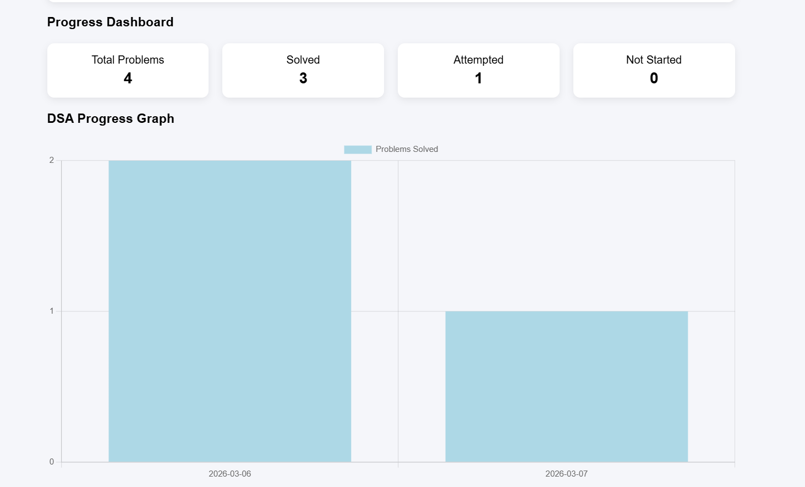
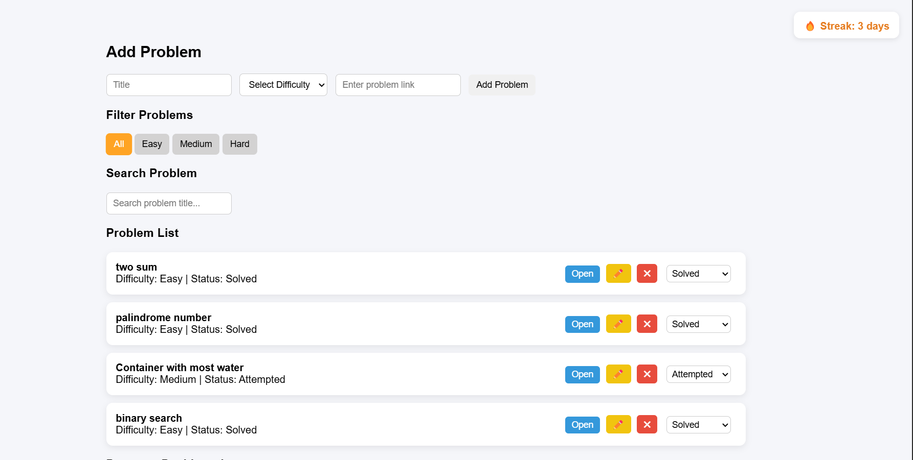

# 🚀 DSA JourneyMate

A **full-stack DSA progress tracker** that helps students organize, track, and revise coding problems efficiently.
It includes a spaced repetition revision system, clean dashboard, streak tracking, and progress analytics.

🌐 **Live Demo:**
https://dsa-journey-mate.vercel.app/


# ✨ Features

- ✔ **Problem Management**
   - Add DSA problems with title, difficulty, problem link, tags, and intuition/logic
   - Update problem status (Not Started, Attempted, Solved)
   - Edit or delete problems anytime with an intuitive edit modal

- ✔ **Search & Filtering**
    - Search problems instantly by title or tag
    - Filter problems by difficulty (Easy, Medium, Hard)
    - Filter by clicking any tag pill (#array, #dp, etc.)

- ✔ **Progress Dashboard**
    - Total problems count
    - Solved problems
    - Attempted problems
    - Not started problems

- ✔ **Daily Streak Tracker**
    - Accurately tracks consecutive days with problems solved
    - Prevents streak corruption when editing problem details

- ✔ **DSA Progress Graph**
    - Interactive bar chart showing problems solved per day
    - Real-time updates as problems are added or marked solved

- ✔ **Spaced Repetition Revision System**
    - Automatically schedules revisions when a problem is solved
    - Revision intervals:
      - Day 1 → Day 3 → Day 7 → Day 14 → Day 30
    - Problems due for review appear in the **Spaced Repetition Due Today** section with a one-click review button.


# 🧠 How It Works

1. Add problems you want to solve.
2. Track your progress as **Attempted or Solved**.
3. View your progress in the **dashboard & graph**.
4. Get reminders for problems that need **spaced repetition revision**.
5. Maintain a **daily streak** while practicing DSA.


# 📸 Screenshots

### Dashboard


### Add Problem


### Revision System


# 🛠 Tech Stack

### Frontend
* HTML5
* CSS3
* JavaScript (ES6+)
* Chart.js

### Backend
* Node.js
* Express.js 5
* MongoDB & Mongoose

### Deployment
* Frontend → Vercel or hosted directly by Express
* Backend → Render / Railway / Local


# ⚙️ Installation & Running Locally

1. Clone the repository

```bash
git clone https://github.com/Toshima17/DSA-JourneyMate.git
cd DSA-JourneyMate
```

2. Install dependencies

```bash
npm install
```

3. Configure Environment File (.env)

Copy `.env.example` to `.env`:

```bash
cp .env.example .env
```

Set your MongoDB URI (or leave blank to use local MongoDB):

```env
PORT=3000
MONGO_URI=your_mongodb_connection_string
```
*(If no `MONGO_URI` is provided, it automatically connects to your local MongoDB instance at `mongodb://127.0.0.1:27017/dsa_journeymate`)*

4. Start the application

```bash
npm start
```

5. Open your browser:

Navigate to **http://localhost:3000**


# 📊 Project Structure

```
DSA-JourneyMate
│
├── frontend
│   ├── index.html       # Clean responsive UI, dashboard, charts, modal
│   └── style.css        # Modern design system & CSS styling
│
├── server.js            # Express 5 REST API & static frontend server
├── package.json         # Scripts and project dependencies
├── .env.example         # Environment variables template
├── .gitignore           # Git ignore list
└── README.md            # Project documentation
```


# 🎯 Future Improvements

* User authentication (JWT / Google Auth)
* Topic tagging (Arrays, Graphs, DP, Trees, etc.)
* AI-based problem hints and complexity analysis
* Weekly progress summary reports


# 👩‍💻 Author

**Toshima Rahangdale**

B.Tech CSE Student  
Samrat Ashok Technological Institute, Vidisha  

GitHub: https://github.com/Toshima17  

⭐ If you like this project, consider giving it a **star** on GitHub!
